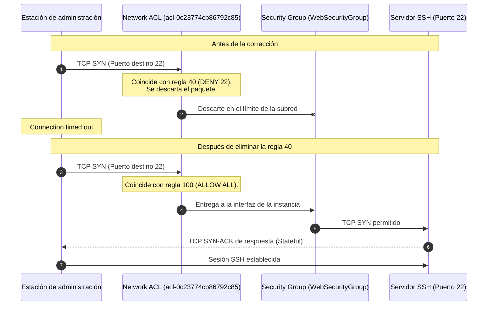

# Diagnóstico y resolución de problemas de red en Amazon VPC (Troubleshoot a VPC)

**Asignatura:** Infraestructura III  
**Estudiante:** Santiago Gómez Robledo  
**Código Estudiantil:** A00400756  
**Entorno:** AWS Academy Learner Lab (Amazon Linux 2, AWS CLI v2, Amazon VPC)  
**Fecha:** Octubre de 2026  

## 1. Topología y arquitectura de red

El laboratorio plantea un escenario de resolución de incidentes en una infraestructura con dos VPCs independientes sin interconexión por peering:

1. **VPC1 (Producción):** Aloja los servidores web y de base de datos de la aplicación *Mom & Pop Café* en una subred pública (`10.0.0.0/16`). Presentaba dos problemas de conectividad:
   - Pérdida de acceso web por HTTP (puerto 80) a la instancia `web-server` (`3.237.193.96`).
   - Imposibilidad de conectar por SSH (puerto 22) para administración remota.
2. **VPC2 (Gestión y diagnóstico):** Aloja una instancia `cli-host` con salida a Internet para ejecutar diagnósticos con AWS CLI y emular peticiones de clientes externos.
3. **Amazon S3:** Bucket de almacenamiento para recolectar los registros de tráfico generados por VPC Flow Logs.

![[Pasted image 20261016093046.png]]


## 2. Inicialización y configuración de AWS CLI

Para interactuar con la infraestructura desde la consola, primero nos conectamos por SSH a la máquina de administración `cli-host` en la VPC2:

```bash
ssh -i labsuser.pem ec2-user@<CliHostIP>
```

Una vez dentro, consultamos el servicio de metadatos de instancia (IMDSv1) en la dirección local de enlace $169.254.169.254$ para verificar en qué región operaba la máquina:

```bash
curl http://169.254.169.254/latest/dynamic/instance-identity/document | grep region
```


*Figura 1: Consulta a IMDSv1 donde se obtiene la región activa `us-east-1`.*

Con la región identificada, ejecutamos `aws configure` para inicializar el cliente con las credenciales del laboratorio y fijar el formato de salida en JSON. Esto permite que el CLI firme criptográficamente cada solicitud al API de AWS mediante SigV4:

```bash
aws configure
```

.png)
*Figura 2: Registro de credenciales y configuración regional en AWS CLI.*


## 3. Instrumentación de observabilidad con VPC Flow Logs

Antes de modificar tablas de enrutamiento o listas de control de acceso, activamos la captura de tráfico sobre la VPC1 para registrar tanto los paquetes aceptados como los denegados. Esto garantiza contar con evidencia de red para cualquier análisis posterior.

Primero creamos un bucket en S3 denominado `flowlog-robledo-1234` y consultamos el ID de la VPC afectada (`vpc-0f6ac08b4c3d2c341`):

```bash
aws s3api create-bucket --bucket flowlog-robledo-1234 --region us-east-1

aws ec2 describe-vpcs \
    --filters "Name=tag:Name,Values='VPC1'" \
    --query 'Vpcs[*].[VpcId,Tags[?Key==`Name`].Value,CidrBlock]'
```

Luego asociamos el servicio de Flow Logs para capturar todo el tráfico (`ALL`) y depositarlo en el bucket S3:

```bash
aws ec2 create-flow-logs \
    --resource-type VPC \
    --resource-ids vpc-0f6ac08b4c3d2c341 \
    --traffic-type ALL \
    --log-destination-type s3 \
    --log-destination arn:aws:s3:::flowlog-robledo-1234
```

.png)
*Figura 3: Creación del bucket y activación de Flow Logs con ID `fl-08c82e7031950e3b3`.*

Para confirmar que el agente de captura estuviera operativo y con permisos suficientes para escribir en S3, ejecutamos `aws ec2 describe-flow-logs`:

.png)
*Figura 4: Salida con estado `ACTIVE` y entrega `SUCCESS` en el bucket de destino.*

A partir de este momento, cualquier intento de conexión a la VPC queda registrado en ventanas de agregación comprimidas con gzip.


## 4. Diagnóstico y solución del fallo web HTTP (Capa 3: Enrutamiento)

El servidor web `web-server` (`3.237.193.96`) no respondía a peticiones HTTP en el navegador, arrojando un error de tiempo de espera agotado (`ERR_CONNECTION_TIMED_OUT`).

Para que una subred en AWS sea pública y entregue tráfico a Internet requiere tres elementos:
1. Una dirección IP pública asociada a la interfaz.
2. Un Internet Gateway (IGW) conectado a la VPC.
3. Una ruta en la tabla de enrutamiento que dirija $0.0.0.0/0$ hacia ese IGW.

Al inspeccionar los metadatos de la instancia verificamos que estaba en ejecución y con la IP pública asignada:

```bash
aws ec2 describe-instances \
    --filter "Name=ip-address,Values='3.237.193.96'" \
    --query 'Reservations[*].Instances[*].[State.Name,PrivateIpAddress,InstanceId,SubnetId]'
```

El problema apareció al examinar la tabla de enrutamiento asociada a la subred pública (`rtb-0afb1902823e16b29`):

```bash
aws ec2 describe-route-tables \
    --route-table-ids rtb-0afb1902823e16b29 \
    --query 'RouteTables[*].Routes'
```

.png)
*Figura 5: La tabla de rutas solo contenía la regla local `10.0.0.0/16` sin salida hacia Internet.*

### Mecanismo de la falla y remediación

El paquete inicial de conexión `TCP SYN` del cliente entraba por el Internet Gateway y llegaba al servidor, pero al responder con `TCP SYN-ACK`, el router virtual de la VPC no tenía ninguna ruta para enviar paquetes hacia la IP pública del cliente y los descartaba silenciosamente.

![[Pasted image 20261016094110.png]]

Para corregir la asimetría de enrutamiento, agregamos la ruta por defecto hacia el Internet Gateway `igw-012807cfae2615a2e`:

```bash
aws ec2 create-route \
    --route-table-id rtb-0afb1902823e16b29 \
    --destination-cidr-block 0.0.0.0/0 \
    --gateway-id igw-012807cfae2615a2e
```

.png)
*Figura 6: Comando `create-route` ejecutado con éxito (`Return: true`).*

Con la ruta en su lugar, el router pudo enviar los paquetes `SYN-ACK` de vuelta al cliente, completando el handshake TCP y permitiendo acceder de inmediato a la aplicación web del café en `http://3.237.193.96/`.


## 5. Diagnóstico y solución del bloqueo SSH (Capa 3 y 4: Network ACL)

Con el acceso web funcionando, intentamos ingresar por SSH a la misma máquina para tareas administrativas:

```bash
ssh -i labsuser.pem ec2-user@3.237.193.96 -o ConnectTimeout=10
```

La conexión falló nuevamente por tiempo de espera agotado. 

Al verificar el Security Group de la instancia, el puerto TCP 22 estaba abierto para `0.0.0.0/0`. Esto indicaba que el bloqueo no ocurría a nivel de interfaz (donde opera el Security Group), sino en el perímetro de la subred, controlado por las Network ACLs (NACL).

Las NACLs son listas sin estado (*stateless*) y evalúan sus reglas en estricto orden numérico ascendente. La primera regla que coincida con el paquete determina si se permite o se descarta.

Consultamos las reglas de la NACL asociada a la subred (`acl-0c23774cb86792c85`):

```bash
aws ec2 describe-network-acls \
    --filter "Name=association.subnet-id,Values='subnet-0bdcc75167d73e72d'" \
    --query 'NetworkAcls[*].[NetworkAclId,Entries]'
```

.png)
*Figura 7: Regla de entrada número 40 configurada explícitamente en `DENY` para el puerto TCP 22.*

La lista tenía tres reglas de entrada relevantes:
- **Regla 40:** Bloqueo (`DENY`) del puerto TCP 22 para `0.0.0.0/0`.
- **Regla 100:** Permiso general (`ALLOW`) para todo el tráfico.
- **Regla asterisco (\*):** Regla por defecto de descarte al final de la lista.

Como $40 < 100$, cualquier paquete entrante dirigido al puerto 22 coincidía con la regla 40 y se descartaba en el borde de la subred, impidiendo que llegara al Security Group de la máquina:



### Remediación

Eliminamos la regla bloqueadora 40 con el comando `delete-network-acl-entry`:

```bash
aws ec2 delete-network-acl-entry \
    --network-acl-id acl-0c23774cb86792c85 \
    --rule-number 40 \
    --ingress
```

.png)
*Figura 8: Eliminación de la regla 40 y primer intento de conexión exitoso solicitando la huella ECDSA.*

Una vez eliminada la regla, el tráfico al puerto 22 fue procesado por la regla 100 (`ALLOW`). Probamos la conexión interactiva desde la máquina local con la clave privada:

.png)
*Figura 9: Sesión SSH abierta en la instancia y verificación del nombre de host `web-server`.*


## 6. Análisis de tráfico con VPC Flow Logs

Para validar con evidencia concreta el comportamiento de los paquetes durante las fallas, descargamos los registros que Flow Logs estuvo depositando en S3.

Los registros de Flow Logs capturan metadatos de capa 3 y 4 en el siguiente formato:

$$\langle \text{version}, \text{account-id}, \text{interface-id}, \text{srcaddr}, \text{dstaddr}, \text{srcport}, \text{dstport}, \text{protocol}, \text{packets}, \text{bytes}, \text{start}, \text{end}, \text{action}, \text{log-status} \rangle$$

Donde:
- `protocol: 6` corresponde al protocolo TCP.
- `action` reporta `ACCEPT` si el paquete pasó tanto la NACL como el Security Group, o `REJECT` si fue bloqueado por alguno de ellos.

Desde `cli-host`, descargamos los archivos del bucket y los descomprimimos:

```bash
mkdir flowlogs && cd flowlogs
aws s3 cp s3://flowlog-robledo-1234/ . --recursive
cd AWSLogs/364810072423/vpcflowlogs/us-east-1/2026/10/16/
gunzip *.gz
ls -l
```

.png)
*Figura 10: Descarga recursiva desde S3, descompresión con `gunzip` y listado de archivos de registro generados.*

Posteriormente filtramos los registros con `grep` buscando paquetes descartados en el puerto 22:

```bash
grep -rn ' 22 ' . | grep REJECT
```

Los registros reflejaron con exactitud los intentos de conexión SSH realizados antes de corregir la NACL:
- La IP origen correspondía a la estación del administrador.
- La IP destino y la interfaz ENI correspondían al servidor web (`3.237.193.96`).
- El puerto destino era el 22 con protocolo 6 (TCP).
- La acción asentada fue `REJECT`, confirmando que el descarte se produjo en la regla 40 de la NACL.


## 7. Comparativa de componentes de red y seguridad

| Componente | Capa OSI | Ámbito | Gestión de estado | Comportamiento observado |
| :--- | :--- | :--- | :--- | :--- |
| **Tabla de enrutamiento** | Capa 3 (Red) | Subred | Determinista por prefijo de destino | Descartaba paquetes de retorno web al carecer de ruta `0.0.0.0/0 -> IGW`. |
| **Network ACL (NACL)** | Capa 3 y 4 (Red / Transporte) | Perímetro de subred | Sin estado (*Stateless*), evaluación en orden numérico ascendente | La regla 40 bloqueaba el puerto 22 antes de evaluar la regla permisiva 100. |
| **Security Group** | Capa 4 (Transporte) | Interfaz virtual (ENI) | Con estado (*Stateful*), solo admite reglas de permiso | Tenía abiertos los puertos 80 y 22, por lo que no causó bloqueos. |

## 8. Conclusiones

1. **Mismo síntoma, distinta capa:** Tanto el fallo del servidor web como el de la sesión SSH producían el mismo error hacia el usuario (`Connection timed out`). Sin embargo, el primero se debía a una falta de ruta en Capa 3 (asimetría en la tabla de enrutamiento), mientras que el segundo obedecía a una regla de filtrado en Capa 4 dentro de la NACL.
2. **Prioridad en reglas sin estado:** En las Network ACLs el orden numérico define qué regla se aplica. Una regla `DENY` con número menor invalida cualquier permiso posterior, independientemente de lo que se defina más abajo o en el Security Group.
3. **Utilidad de la telemetría:** VPC Flow Logs permite confirmar objetivamente si un paquete fue aceptado o rechazado y en qué momento, sin necesidad de instalar agentes dentro del sistema operativo ni interrumpir el servicio.
